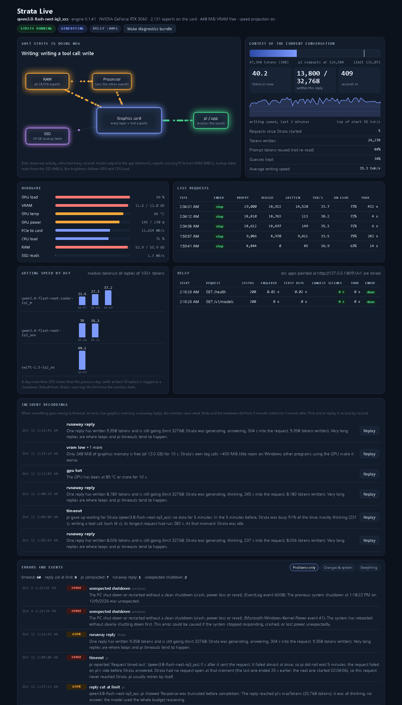
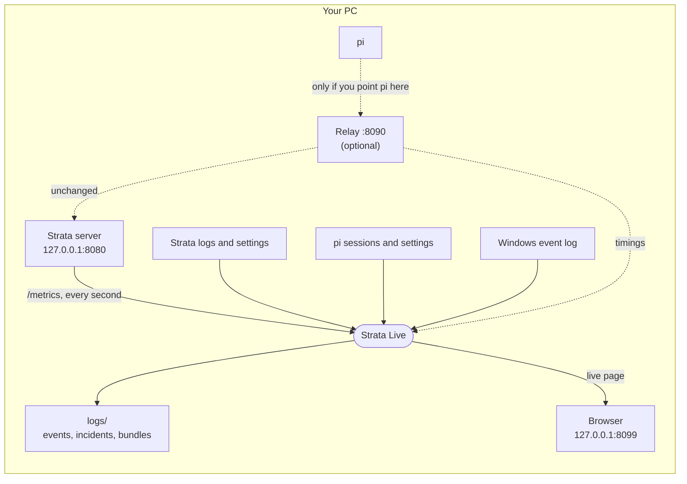

<h1 align="center">Strata Live</h1>

<p align="center"><b>A live dashboard, error log and troubleshooting kit for <a href="https://github.com/Niko1221/Strata">Strata</a></b><br>
See what your PC is doing while Strata answers, and find out why replies time out, get cut off or lose context.</p>

<p align="center">
  
  
  
  
</p>

<p align="center"></p>
<p align="center"><sub>Strata Live 0.3 on an RTX 3060 (12 GB), Ryzen 5 5600X and 56 GB of RAM, running Qwen3.8-Flash-Next IQ3_XXS with engine 0.1.41 and pi 1.1.0.</sub></p>

## What you get

**Watch it live**

| | |
| --- | --- |
| **Live diagram** *(experimental)* | Dots flow between the SSD, RAM, processor, graphics card and your app at the real rates: tokens per second, PCIe and SSD traffic. The boxes glow with GPU and CPU load. |
| **What Strata is doing** | "Reading the prompt: 40,000 of 90,000 tokens" or "Writing a tool call: write", with live tokens per second and a 2-minute speed chart. |
| **Context gauge** | How full the conversation is, out of Strata's limit, with a marker where pi will compact it. |
| **Hardware** *(experimental)* | GPU load, VRAM, temperature, power, PCIe, CPU, RAM and SSD reads, for the whole PC. |
| **Last requests** | How each reply ended (finished, length limit or app hung up), its size, speed and how many experts were found on the card. |
| **Writing speed by day** | The median speed of each model per day, rebuilt from Strata's own logs the first time it runs. |

**Find out what went wrong**

| | |
| --- | --- |
| **Error log** | Timeouts, context refusals, cut-off replies and compactions, each matched to the Strata request it belongs to, saved to a file. |
| **Incident recordings** | When something goes wrong, it saves what Strata and the hardware did from 5 minutes before to 1 minute after. Replay it second by second on a timeline of speed, GPU load and free graphics memory. |
| **Early warnings** | Low graphics memory, full RAM, a hot GPU, runaway replies, very slow tool calls, and a day that is much slower than usual. |
| **Settings changes** | Every change to Strata's `strata-*.json`, its engine version and pi's settings, with what changed (`--pcie-frac 0.35 -> 0.55`), even changes made while the monitor was off. |
| **Windows events** | Graphics driver resets, hardware errors, Windows running out of memory, and unexpected shutdowns. |
| **Relay (optional)** | Sits between pi and Strata and times every request: when Strata answered, when data first came, and the longest silence. The surest way to see whether a request even reached Strata. |
| **Diagnostics bundle** | One click packs recent events, incident recordings, settings (secrets hidden) and Strata's log tails into a zip for a bug report. Your conversations are not included. |

## How it works

Strata Live only reads. It never changes Strata, its models or your AI app.



## Desktop window (no web server)

Double-click **`start-strata-monitor.bat`**. It opens **Strata Monitor**, a normal Windows window built on Python's own
tkinter, so there is nothing to install and no web server to start. It looks like a starship engineering console,
with Strata drawn as the warp core; `strata_monitor.pyw --classic` gives a plain window instead. It runs the same watchers and writes the same
logs as the web page.

It also adds:
- a settings check (pi's model and limits against what Strata serves, and thinking off on both sides)
- a compaction watch (how often, summary size, who wrote it)
- a "last hour" bar showing where Strata's time went
- a request history with timestamps (`logs\requests-<date>.jsonl`)

**The engineering console (the default since 2026-10-13).** The sidebar holds 9 departments (F1–F9): Main
engineering, Warp core, Core control, Power & coolant, Comms · pi link, Diagnostics, Ship's log, Reports and
Maintenance. Unlike the web page, the console can also **control** Strata through its own API:
- tune the temperature and other settings with sliders
- put the engine on standby, restart it, or shut it down and start it again
- run speed trials
- write reports

It acts only when you click, takes two clicks for anything that changes Strata, and logs every change to
`logs\tuning.jsonl`. `--page=N` opens it on department N. The plan is in `UI-PLAN.md`.

Run either the window or the web page, not both, since they write the same event logs. Details:
`CHANGES-2026-10-13.md`.

## Quick start

**Windows**

1. Download this folder anywhere outside your Strata folder, for example `D:\strata-live`.
2. Open `start-strata-live.bat` in Notepad. Point it at a Python 3.9+ (Strata's own `.venv\Scripts\python.exe` works),
   and set `STRATA_DIR` if your Strata folder isn't `D:\strata`.
3. Double-click `start-strata-live.bat`. The page opens at **http://127.0.0.1:8099**.

**Linux**

```sh
STRATA_DIR=~/strata python3 strata_live.py
```

Close the window, or press Ctrl+C, to stop it. Starting it a second time just opens the page that is already running.

> **Let your AI set it up:** give your coding assistant [SETUP_FOR_AI.md](SETUP_FOR_AI.md). It has every step, the
> checks to run, and the rule never to touch your Strata install.

### Using the relay

1. Start `start-strata-live-with-relay.bat` instead. It adds a relay on `127.0.0.1:8090`.
2. In pi's `~/.pi/agent/models.json`, change `baseUrl` from `http://127.0.0.1:8080/v1` to `http://127.0.0.1:8090/v1`.
3. Use pi as normal. The Relay panel shows each request's timings, and the log warns when a request gets no data for 60 or 240 seconds.
4. When you're done, set `baseUrl` back to `8080`.

The relay passes every request and answer through unchanged and streams each piece the moment it arrives.

## What it logs

| Event | What it means |
| --- | --- |
| 🔴 `timeout` | pi reported "Request timed out." The event says how many seconds after sending the request it happened, what Strata was doing, and whether Strata had a request open at that moment. |
| 🔴 `context too long` | Strata refused a request because the prompt plus the reply limit didn't fit. Strata never cuts a prompt by itself. |
| 🟠 `reply cut at limit` | A reply stopped at the app's `max_tokens` (pi shows "Response was truncated before completion."). Says whether it was all thinking with no answer, or a huge tool call. |
| 🟠 `pi compacted` | pi summarised the conversation because it neared the limit. |
| 🟠 `app hung up` | The app closed the connection before the reply finished. |
| 🟠 `conversation shortened` | The prompt suddenly got much smaller: the app compacted or restarted the chat. |
| 🟠 `near context limit` | A request used more than 85% of Strata's context. |
| 🟠 `runaway reply` | One reply is past 8,000 tokens and still going. Loops tend to happen here. |
| 🟠 `slow tool call` | The model has been writing one tool call (often a file) for over 5 minutes. |
| 🟠 `queue` / `long request` | Requests waited over 2 minutes, or one ran over 10 minutes. |
| 🟠 `vram low` / `ram full` / `gpu hot` | Under 250 MiB of graphics memory free, RAM over 95%, or the GPU at 85 °C or more, each for 10 seconds. |
| 🟠 `slowdown` | A model's median speed today (10+ replies) is over 25% below its previous days. |
| 🟠 `relay silence` | A request through the relay has had no data from Strata for 60 or 240 seconds. |
| 🔴 `graphics driver reset` / `hardware error` / `unexpected shutdown` | From Windows' event log. |
| 🟠 `windows low memory` | Windows ran low on memory. |
| ⚪ `config changed` | A Strata or pi setting changed. Shown under **Changes & system**. |
| 🔴 `log error` / 🟠 `warning` | A matching line in a Strata log. |
| 🟠 `server` | Strata stopped answering (3 missed checks in a row) or came back. |

Every error, and the warnings for runaway replies, slow tool calls, low VRAM, full RAM, a hot GPU, relay silence,
low Windows memory or Strata going down, also saves an **incident recording** to `logs/incidents/`. Problems within
90 seconds of each other share one recording.

## Files it writes

| In `logs/` | |
| --- | --- |
| `events-<date>.log` | every event, to read |
| `events.jsonl` | the same, for tools (trimmed past 20 MB) |
| `incidents/` | incident recordings |
| `bundles/` | diagnostics bundles |
| `relay-<date>.log` | one line per relayed request |
| `speed-history.json` | writing speed per model per day |
| `config-state.json` | the last seen settings, to spot changes (secrets stored as `***`) |
| `windows-events.json` | Windows events already reported |

Logs, relay logs and incidents older than 30 days and bundles older than 14 days are deleted automatically.

## Settings

| Environment variable | Default | |
| --- | --- | --- |
| `STRATA_URL` | `http://127.0.0.1:8080` | Strata's server |
| `STRATA_DIR` | `D:\strata` | your Strata folder (logs and settings) |
| `STRATA_LIVE_PORT` | `8099` | port of the live page |
| `STRATA_RELAY_PORT` | (off) | turns the relay on at this port, for example `8090` |
| `STRATA_API_KEY` | (empty) | only if Strata runs with `--api-key` |

The warning levels and how long files are kept are constants at the top of `strata_live.py` (`VRAM_LOW_MIB`,
`RAM_FULL_PCT`, `GPU_HOT_C`, `RUNAWAY_TOKENS`, `TOOL_CALL_SLOW_S`, `SLOWDOWN_PCT`, `LOG_KEEP_DAYS`, ...).

## Files

| File | |
| --- | --- |
| `strata_live.py` | the monitor, relay and web server (standard library only) |
| `live.html` | the live page |
| `start-strata-live.bat` | Windows launcher |
| `start-strata-live-with-relay.bat` | Windows launcher with the relay on port 8090 |
| `SETUP_FOR_AI.md` | setup guide for AI coding assistants |
| `docs/screenshot.png` | the picture above |

## What it found on the PC it was built on

The first real findings came from using Strata Live on its own development PC. They show the kind of answers it
gives:

- **"Request timed out" in pi:** all 60 timeouts were recorded 0 to 2 seconds after pi sent the request, and pi
  retried 2 seconds later. In the one case with full Strata data, Strata had no request open at that moment, so the
  request failed on pi's side before reaching Strata. These were not slow answers. The relay is there to confirm the
  rest.
- **"Response was truncated before completion" in pi:** 7 of 8 were replies that spent the whole token budget
  thinking and never answered. Strata's `reasoning_budget_tokens` setting caps the thinking.

## Good to know

- **Experimental: the live diagram and hardware bars show the whole PC, not just Strata.** GPU load, VRAM, PCIe,
  CPU, RAM and SSD reads come from Strata's `/metrics`, which measures the whole machine. Other programs (a browser,
  Discord, a virus scanner, a game) can make the diagram move and the bars rise while Strata says "Idle: waiting for
  a request". That activity is real, but it is not Strata's. The same goes for the `vram low`, `ram full` and
  `gpu hot` warnings and the hardware graphs in incident recordings. Request results, speeds, timeouts, cut-off
  replies, compactions and the speed history come from Strata and pi only, so other programs never add to them.
  A program that loads the GPU heavily can still make Strata genuinely slower, and that slower speed is logged as it
  happened.
- **Safe by design.** It only reads Strata's status page and files. Its page and relay listen on `127.0.0.1` only,
  and a diagnostics bundle can only be made from its own page.
- **pi is optional.** Without pi, everything except the pi events still works.
- **The compaction marker** assumes pi's default `reserveTokens` of 16,384. Change `PI_COMPACT_RESERVE` in
  `strata_live.py` if yours differs.
- **Strata's own Monitor tab** shows similar live numbers. Strata Live adds the history, the error log and pi's side
  of the story.
- **Tested** on Windows 11 with Strata engine 0.1.41 and pi 1.1.0. Linux and AMD cards should work but are not
  tested yet (the Windows event part is Windows only).

## Credits

Built for [Strata](https://github.com/Niko1221/Strata), which runs Qwen3.8-Flash-Next on a normal PC. Strata Live is a
separate project and is not part of Strata.
